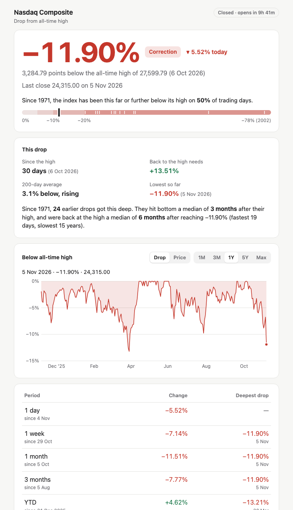

# AI Bubble Detector

*for the pessimistic coder, lol*

**Just in case the bubble really happens.**

Everyone says they'll buy the dip. Then the dip comes, the headlines are terrifying, and nobody does.

This little tool takes that decision away from you. Once a day it looks at the Nasdaq, compares it
to a fixed buy-the-crash ladder, and tells you in one line whether today is a day to buy or a day to
go back to bed. Most days it says nothing is happening. That's the point.

> **Not financial advice.** Fixed rules, public data, zero knowledge of your life. Pick your own
> levels and amounts while the market is boring, then let the robot do the remembering.

---

## What you get

Run it and you get:

```
>>> No buy today <<<
    Nearest rung Buy 1 is 4,737 points (18.62%) below the last close.
```

or, on a very bad (good?) day:

```
>>> BUY TODAY: BUY 1 FIRED AT THIS CLOSE <<<
    Index closed at or below the Buy 1 level (20,699.84, -25% from ATH).
```

Plus a dark-mode HTML report with a chart, a PDF of the same, and a CSV log that grows by one row
per trading day. On a Mac it can run itself every morning and ping you only when there's something
to do. And there's a [live web page](#the-web-page) for checking the damage from your phone.

### The report

<p align="center">
  <a href="docs/sample-report.pdf"></a>
</p>

Open the sample as a [PDF](docs/sample-report.pdf) or download the self-contained
[HTML](docs/sample-report.html) (GitHub shows HTML as source; save it and open it in a browser).

### The web page

**[bubble-detector-silk.vercel.app](https://bubble-detector-silk.vercel.app)** answers one question
at a glance: how far is the Nasdaq below its all-time high, and how bad is that? No buy ladder here,
just the drop and the history around it.

<p align="center">
  <a href="https://bubble-detector-silk.vercel.app"></a>
</p>

- **The drop, with context.** A plain label (Near the high, Pullback, Correction, Bear market), the
  day's move, how often since 1971 the index has been this far down, and a gauge against every past
  crash.
- **This drop.** How long it has lasted, the gain needed to get back to the high, where the index
  sits against its 200-day average, and how earlier drops that got this deep played out: how long
  they took to bottom and to recover.
- **A chart you can explore.** Hover or drag for the date, drop and price. Switch between the drop
  and the price (with the all-time high as a dashed line), and between 1M, 3M, 1Y, 5Y and Max; Max
  goes back to 1971 and marks every fall of 20% or more.
- **Past crashes.** Every fall of 20% or more since 1971: how deep, how long it fell, how long it
  took to recover. Tap one and the chart glides to it.
- **Change and deepest drop per period.** Tap a row to highlight that period on the chart.
- **Live.** Market open or closed with countdowns, a fresh copy every hour while the market is open,
  and new numbers swapped in (and briefly highlighted) without reloading the page.
- **Animated, gently.** The headline counts up, the chart draws itself in and morphs between views,
  the gauge slides into place. All of it switches off if your device asks for reduced motion.
- **Installs like an app.** "Add to Home Screen" gives it the bubble icon and a full-screen window,
  and it shows the last copy when you're offline.
- **Share** button, link previews, and the numbers as JSON at
  [`/data.json`](https://bubble-detector-silk.vercel.app/data.json), readable from any site.

Preview it locally (writes `site/index.html` and `site/data.json`):

```bash
python -m bubble_detector.web
```

**Hosting your own.** Import the repo into [Vercel](https://vercel.com); `vercel.json` already sets
it up, no settings or keys needed. `api/index.py` builds the page on request and Vercel's cache keeps
it until the next update (hourly while the market is open, otherwise until the next open, with US
holidays and half days accounted for). When a copy expires, visitors get the previous one while a
new one is fetched, so nobody waits on Yahoo.

---

## The rules

- **The ladder.** Four buy levels below the all-time high: **-25%, -40%, -55%, -70%**.
  A rung fires the day the index closes at or below it. You're told once, not nagged.
- **Buy 5, the recovery.** After a crash (Buy 1 has fired), the last buy comes when the index climbs
  back above a rising 200-day average. Before any crash it just says "not armed".
- **Everything else** on the report is context: changes over 1 day to 1 year, distance to the
  200-day average, and two ASX ETFs for reference.

All the numbers are in `bubble_detector/config.py`, each one explained with examples.

---

## Quick start

Needs Python 3.9 or newer. The `python3` that ships with macOS is fine.

```bash
git clone https://github.com/is0xjh25/bubble-detector.git
cd bubble-detector
./run.sh
```

That's it. The first run creates a virtual environment in `.venv`, installs the two dependencies,
runs the check, and opens the report in your browser. Later runs skip straight to the check.

Prefer to set things up by hand? Same result:

```bash
python3 -m venv .venv && source .venv/bin/activate
pip install -r requirements.txt
python -m bubble_detector
```

Flags you might want:

| | |
|---|---|
| `./run.sh --no-open` | don't open the browser |
| `./run.sh --no-pdf` | skip the PDF |
| `./run.sh --json` | machine-readable output |

Output lands in `reports/`: `history.csv` (the log), `latest.html`, and dated copies that are
cleaned up after 90 days.

**PDF** needs WeasyPrint's system libraries (`brew install pango` on macOS). Without them the PDF
is skipped and everything else still works.

**Want a newer Python?** `brew install uv`, then `uv venv --python 3.12 .venv` and
`uv pip install -r requirements.txt`. If `uv` is installed, `run.sh` uses it automatically.

---

## Let it run itself (macOS)

```bash
schedule/install-schedule.sh      # every Tue–Sat at 08:30, change it in config.py
schedule/build-notifier.sh        # optional: notifications with the bubble icon
```

You'll get a notification only on BUY, RECOVERY, or if the run fails. The rest of the time it's
silent, like a smoke alarm that respects you.

Two macOS gotchas, both handled for you as far as possible:

- **Folder permission.** macOS won't let background jobs read `~/Documents`, `~/Desktop` or
  `~/Downloads`. The install script checks this and tells you if you're affected. The fix is either
  to keep the project somewhere else (for example `~/bubble-detector`), or to give bash Full
  Disk Access: System Settings → Privacy & Security → Full Disk Access → **+** → press ⌘⇧G, type
  `/bin/bash`, Open → make sure the switch is on → run the install script again.
- **Notifications.** Click **Allow** the first time it asks.

On Linux, point cron at `run.sh --no-open --notify` instead.

---

## Data

Prices come from [yfinance](https://github.com/ranaroussi/yfinance): free, no key, occasionally
grumpy. Swapping providers means replacing one function; see [`PROVIDERS.md`](PROVIDERS.md).

## Tests

```bash
python -m unittest -v
```

## License

[MIT](LICENSE). If it helps you buy the bottom, you owe me nothing. If it doesn't, see the
disclaimer at the top.

Built by [is0xjh25](https://github.com/is0xjh25).
