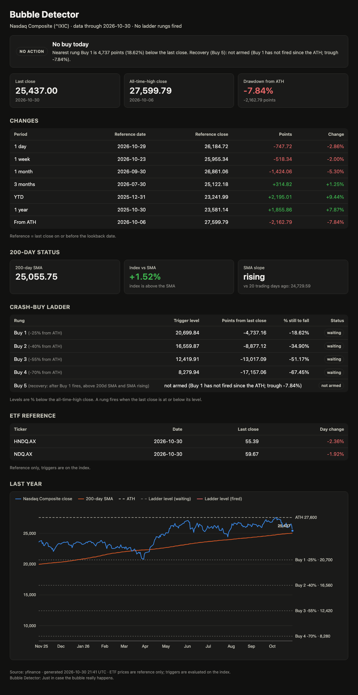

# AI Bubble Detector

*for the pessimistic coder, lol*

**Just in case the bubble really happens.**

Everyone says they'll buy the dip. Then the dip comes, the headlines are terrifying, and nobody does.

This little tool takes that decision away from you. Once a day it looks at the Nasdaq, compares it
to a fixed buy-the-crash ladder, and tells you in one line whether today is a day to buy or a day to
go back to bed. Most days it says nothing is happening. That's the point.

> **Not financial advice.** Fixed rules, public data, zero knowledge of your life. Pick your own
> levels and amounts while the market is boring, then let the robot do the remembering.

---

## What you get

Run it and you get:

```
>>> No buy today <<<
    Nearest rung Buy 1 is 4,737 points (18.62%) below the last close.
```

or, on a very bad (good?) day:

```
>>> BUY TODAY: BUY 1 FIRED AT THIS CLOSE <<<
    Index closed at or below the Buy 1 level (20,699.84, -25% from ATH).
```

Plus a dark-mode HTML report with a chart, a PDF of the same, and a CSV log that grows by one row
per trading day. On a Mac it can run itself every morning and ping you only when there's something
to do.

### The report

<p align="center">
  <a href="docs/sample-report.pdf"></a>
</p>

Open the sample as a [PDF](docs/sample-report.pdf) or download the self-contained
[HTML](docs/sample-report.html) (GitHub shows HTML as source; save it and open it in a browser).

---

## The rules

- **The ladder.** Four buy levels below the all-time high: **-25%, -40%, -55%, -70%**.
  A rung fires the day the index closes at or below it. You're told once, not nagged.
- **Buy 5, the recovery.** After a crash (Buy 1 has fired), the last buy comes when the index climbs
  back above a rising 200-day average. Before any crash it just says "not armed".
- **Everything else** on the report is context: changes over 1 day to 1 year, distance to the
  200-day average, and two ASX ETFs for reference.

All the numbers are in `bubble_detector/config.py`, each one explained with examples.

---

## Quick start

Needs Python 3.10+.

```bash
git clone https://github.com/is0xjh25/ai-bubble-detector.git
cd ai-bubble-detector
python3 -m venv .venv && source .venv/bin/activate
pip install -r requirements.txt
./run.sh
```

That runs the check and opens the report in your browser. Flags you might want:

| | |
|---|---|
| `./run.sh --no-open` | don't open the browser |
| `./run.sh --no-pdf` | skip the PDF |
| `./run.sh --json` | machine-readable output |

Output lands in `reports/`: `history.csv` (the log), `latest.html`, and dated copies that are
cleaned up after 90 days.

**PDF** needs WeasyPrint's system libraries (`brew install pango` on macOS). Without them the PDF
is skipped and everything else still works.

**Old Python?** macOS ships 3.9. `brew install uv && uv venv --python 3.12 .venv` gets you a 3.12.

---

## Let it run itself (macOS)

```bash
schedule/install-schedule.sh      # every Tue–Sat at 08:30, change it in config.py
schedule/build-notifier.sh        # optional: notifications with the bubble icon
```

You'll get a notification only on BUY, RECOVERY, or if the run fails. The rest of the time it's
silent, like a smoke alarm that respects you.

Two macOS gotchas:

- Background jobs can't read `~/Documents`, `~/Desktop` or `~/Downloads`. Keep the project
  elsewhere, or give `/bin/bash` Full Disk Access in System Settings.
- Click **Allow** the first time it asks to send notifications.

On Linux, point cron at `run.sh --no-open --notify` instead.

---

## Data

Prices come from [yfinance](https://github.com/ranaroussi/yfinance): free, no key, occasionally
grumpy. Swapping providers means replacing one function; see [`PROVIDERS.md`](PROVIDERS.md).

## Tests

```bash
python -m unittest -v
```

## License

[MIT](LICENSE). If it helps you buy the bottom, you owe me nothing. If it doesn't, see the
disclaimer at the top.
